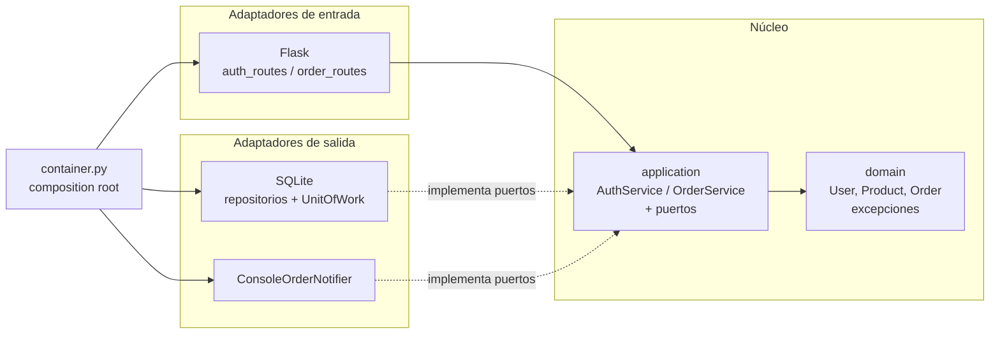
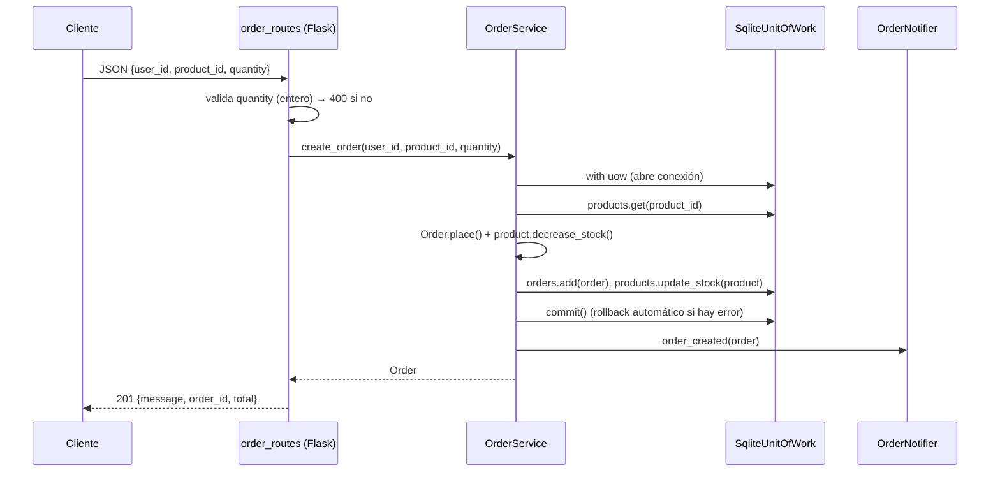

# Arquitectura de OrderHub: Hexagonal (Puertos y Adaptadores)

> **Requisitos cubiertos:** RNF-01.1 (Arquitectura Limpia/Hexagonal, Repository Pattern, Dependency Injection), RF-01.1 (inicio de sesión), HU-03 (desacoplamiento de `/create_order`).
> **Estado:** primer avance de la Unidad I. La persistencia sigue siendo SQLite (`orderhub.db`).

## 1. Problema del sistema legado

En la v1.0 todo vivía en `app.py`. Cada handler de Flask mezclaba cuatro responsabilidades: HTTP, reglas de negocio, SQL y notificaciones (`print`). En concreto:
- `/login` armaba el SQL concatenando texto (inyección SQL) y devolvía la contraseña en la respuesta.
- `/create_order` validaba stock, calculaba el total, insertaba, descontaba stock y "notificaba" en el mismo bloque, sin rollback.
- No se podía probar ninguna regla de negocio sin levantar Flask y una base de datos.

## 2. Regla de dependencias



Las dependencias apuntan **siempre hacia el núcleo**. `domain/` y `application/` no importan `flask` ni `sqlite3`. Solo conocen los **puertos** (clases abstractas), y los adaptadores son quienes los implementan.

## 3. Estructura de directorios

```
orderhub/
├── __init__.py              # create_app(): fábrica de Flask
├── container.py             # Composition root (Dependency Injection manual)
├── domain/
│   ├── entities.py          # User, Product, Order (+ reglas: stock, total, cantidad > 0)
│   └── exceptions.py        # InvalidCredentials, ProductNotFound, InsufficientStock, InvalidInput
├── application/
│   ├── ports/
│   │   ├── repositories.py  # UserRepository, ProductRepository, OrderRepository
│   │   ├── unit_of_work.py  # UnitOfWork (transacción atómica)
│   │   └── notifier.py      # OrderNotifier
│   └── services/
│       ├── auth_service.py  # Caso de uso: login (RF-01.1)
│       └── order_service.py # Casos de uso: crear y listar órdenes
└── adapters/
    ├── inbound/web/         # Flask: blueprints, serializadores, manejo de errores, templates
    └── outbound/
        ├── persistence/sqlite/  # Repositorios SQLite (consultas parametrizadas), esquema y UoW
        └── notifications/       # ConsoleOrderNotifier
tests/
├── unit/                    # Servicios probados con adaptadores falsos en memoria
└── integration/             # API completa con SQLite temporal
```

Equivalencia con HU-03: `repositories/order_repository.py` → `adapters/outbound/persistence/sqlite/order_repository.py`; `services/order_service.py` → `application/services/order_service.py`.

`database.py` (legado) se conserva solo como referencia. Ya nada lo importa: su lógica vive en `adapters/outbound/persistence/sqlite/connection.py` y `schema.py`.

## 4. Patrones aplicados

| Patrón | Dónde | Para qué |
| :--- | :--- | :--- |
| **Puertos y Adaptadores** | `application/ports` ↔ `adapters/` | Cambiar Flask, SQLite o el notificador sin tocar el negocio. |
| **Repository** | `UserRepository`, `ProductRepository`, `OrderRepository` | Ocultar el SQL detrás de operaciones de dominio (`get_by_username`, `add`, ...). |
| **Unit of Work** | `UnitOfWork` / `SqliteUnitOfWork` | Crear la orden y descontar el stock en una sola transacción (RF-03.3). |
| **Dependency Injection** | `container.py`, constructores de los servicios | Los servicios reciben sus dependencias; los tests inyectan versiones falsas. |
| **Application Factory** | `create_app()` | Crear la app con distintas configuraciones (producción y tests). |

## 5. Flujo de una petición: `POST /create_order`



Las excepciones de dominio se traducen a HTTP en `adapters/inbound/web/error_handlers.py` (401/404/400). Los errores no controlados devuelven 500 sin exponer el detalle interno.

## 6. Cambios de comportamiento respecto al legado

| Endpoint | Antes | Ahora |
| :--- | :--- | :--- |
| `POST /login` | Inyección SQL posible (`' OR '1'='1`); devolvía `password` | Consulta parametrizada → 401; la respuesta no incluye `password` |
| `POST /login` (error interno) | 500 con el texto de la excepción | 500 genérico; el detalle va al log |
| `POST /create_order` | Aceptaba `quantity` ≤ 0 (aumentaba el stock); `quantity` no numérico → 500 | 400 en ambos casos |
| Notificación | `print()` | `logging` a través del puerto `OrderNotifier` |

Las rutas, los cuerpos de respuesta y los códigos de éxito no cambian.

## 7. Próximos pasos que esta estructura facilita

- **RF-01.2 (bcrypt):** agregar un puerto `PasswordHasher` y usarlo en `AuthService._password_matches`.
- **RF-01.3 (JWT):** agregar un puerto `TokenIssuer` y emitir el token en `auth_routes`.
- **RNF-02.1 (.env):** leer `DB_PATH` y `SECRET_KEY` del entorno en `app.py`.
- **PostgreSQL/SQLAlchemy:** agregar `adapters/outbound/persistence/postgres/` y cambiar una línea en `container.py`.
- **RF-04.1 (notificación asíncrona):** otro adaptador de `OrderNotifier` (cola o correo).

## 8. Cómo ejecutar

```bash
pip install -r requirements.txt
python app.py          # http://localhost:5000
python -m pytest -q    # pruebas unitarias y de integración
```
