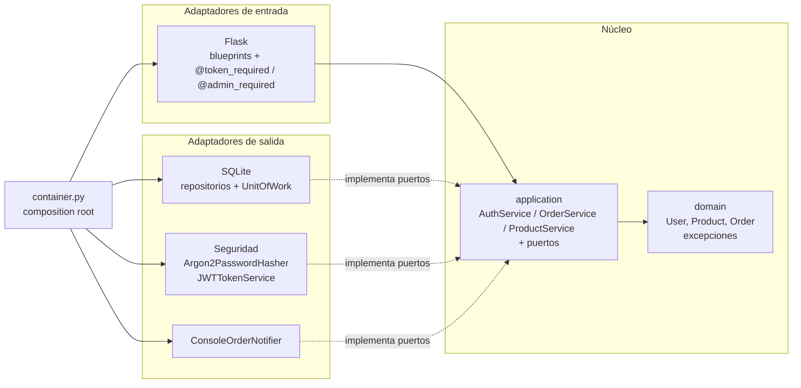
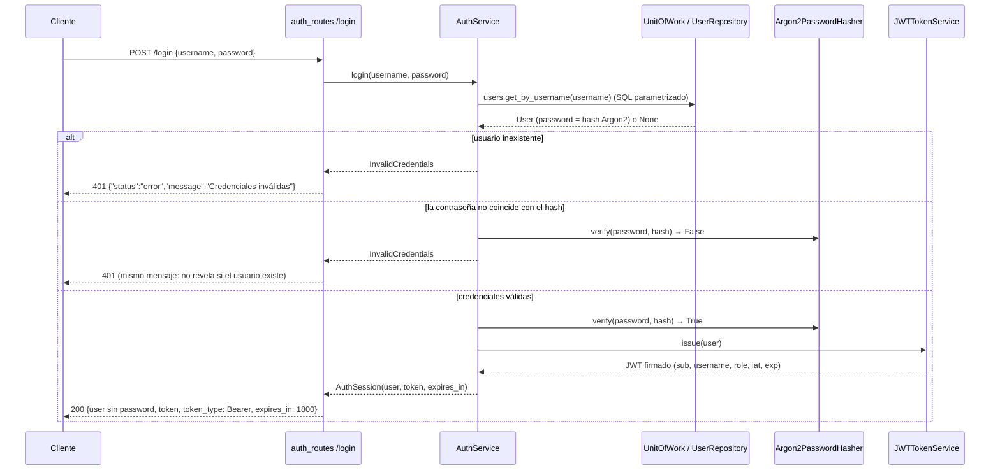
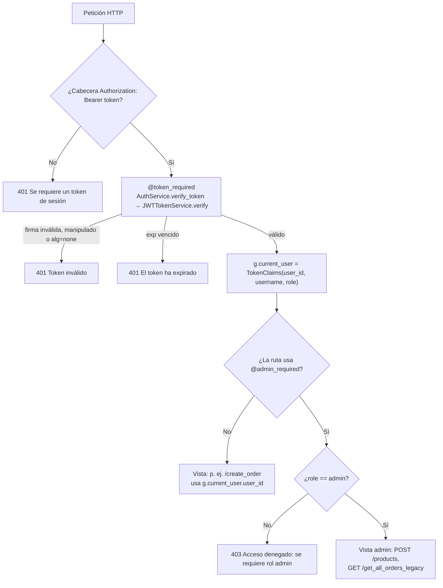
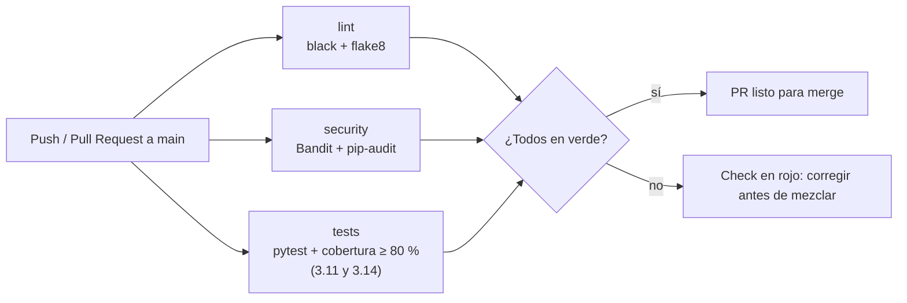
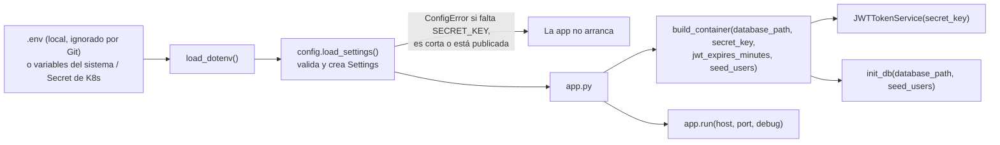
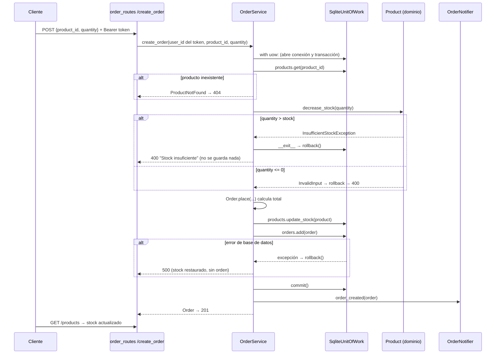
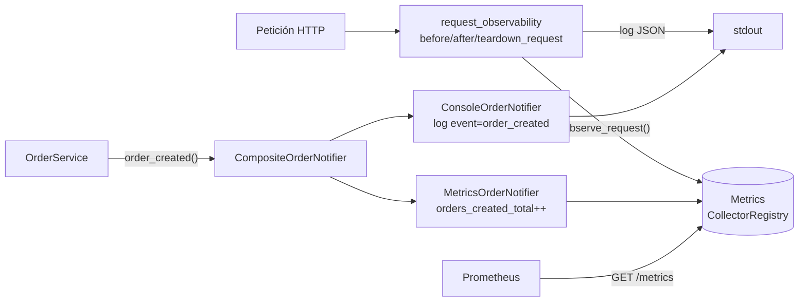
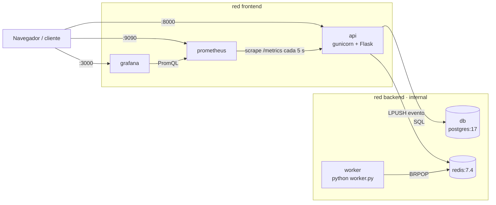
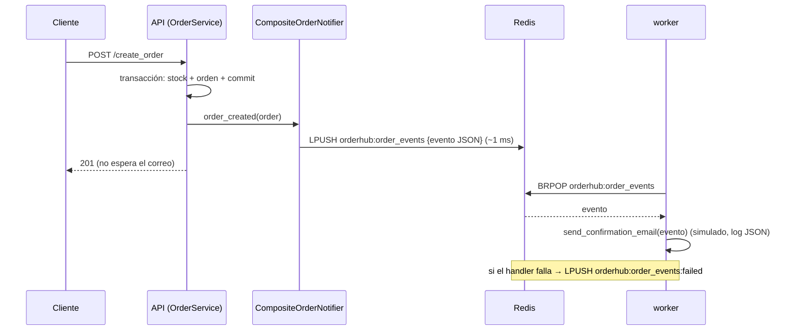
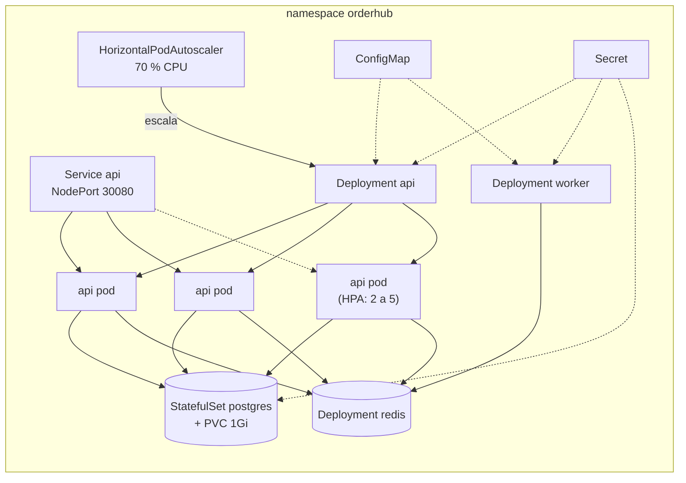

# Arquitectura de OrderHub: Hexagonal (Puertos y Adaptadores)

> **Requisitos cubiertos:**
> - **Primera entrega:** RNF-01.1 (arquitectura hexagonal, Repository Pattern, Dependency Injection), RF-01.1 (inicio de sesión), HU-03.
> - **Segunda entrega:** RF-01.2 (hashing Argon2), RF-01.3 (sesión JWT), RF-01.4 (control de acceso por rol), RNF-01.2 (pruebas de login), RNF-01.3 (PEP 8 con `flake8` y `black`).
> - **Tercera entrega:** RF-02 (catálogo e inventario: `GET /products`, `decrease_stock`, descuento transaccional), RNF-02.1 (configuración por variables de entorno, sin secretos en el código) y RNF-02.2 (todas las consultas parametrizadas, con una prueba que lo vigila).
>
> **Estado:** la persistencia sigue siendo SQLite (la ruta se configura con `DATABASE_PATH`). Toda la configuración sensible se lee del entorno o del archivo `.env` (ver sección 11).

## 1. Resumen del sistema

OrderHub es una API Flask que gestiona usuarios, catálogo de productos y órdenes de compra. Está organizada en tres anillos:

| Anillo | Contenido | Depende de |
| :--- | :--- | :--- |
| **Dominio** (`domain/`) | Entidades `User`, `Product`, `Order` y excepciones de negocio | Nada |
| **Aplicación** (`application/`) | Casos de uso (`AuthService`, `OrderService`, `ProductService`) y **puertos** | Dominio |
| **Adaptadores** (`adapters/`) | Flask (entrada); SQLite, Argon2, JWT y notificador (salida) | Aplicación y dominio |

### Componentes de seguridad

| Componente | Tipo | Responsabilidad | Requisito |
| :--- | :--- | :--- | :--- |
| `PasswordHasher` | Puerto | Contrato para calcular y verificar hashes de contraseñas | RF-01.2 |
| `Argon2PasswordHasher` | Adaptador de salida | Argon2id con sal aleatoria (`argon2-cffi`) | RF-01.2 |
| `TokenService` / `TokenClaims` | Puerto | Contrato para emitir y validar tokens; identidad extraída del token | RF-01.3 |
| `JWTTokenService` | Adaptador de salida | JWT HS256 con `sub`, `username`, `role`, `iat` y `exp` (30 min por defecto) | RF-01.3 |
| `AuthService` | Caso de uso | `register`, `login` (emite el token) y `verify_token` | RF-01.1 a RF-01.3 |
| `@token_required` | Decorador web | Exige `Authorization: Bearer <token>` válido → si no, 401 | RF-01.3 |
| `@admin_required` | Decorador web | Exige token válido con rol `admin` → 401 sin token, 403 con otro rol | RF-01.4 |
| `error_handlers.py` | Adaptador web | Traduce `InvalidCredentials`/`InvalidToken` a 401, `AccessDenied` a 403 y `UserAlreadyExists` a 409 | — |
| `schema.init_db` | Adaptador de salida | Guarda con hash las contraseñas semilla (que llegan del entorno) y migra las contraseñas legadas en texto plano | RF-01.2 |
| `config.load_settings` / `Settings` | Configuración | Lee `SECRET_KEY`, la ruta de la BD, la vigencia del token, el modo debug y las contraseñas semilla desde el entorno o el `.env`; rechaza claves ausentes, cortas o ya publicadas | RNF-02.1 |

### Endpoints

| Método y ruta | Protección | Descripción |
| :--- | :--- | :--- |
| `GET /` | Pública | Panel HTML para probar todos los endpoints (ver sección 10) |
| `POST /register` | Pública | Crea un usuario con rol `client` |
| `POST /login` | Pública | Devuelve el usuario (sin contraseña) y un JWT |
| `POST /create_order` | `@token_required` | Crea una orden a nombre del usuario del token |
| `GET /get_all_orders_legacy` | `@admin_required` | Lista las órdenes de todos los usuarios |
| `GET /products` | Pública | Lista los productos con su precio y stock actual (RF-02.1) |
| `POST /products` | `@admin_required` | Crea un producto (operación administrativa) |
| `GET /metrics` | Pública | Métricas Prometheus (sección 13) |
| `GET /healthcheck` | Pública | Sonda de salud para Docker, Kubernetes y Azure (sección 14) |

## 2. Regla de dependencias



Las dependencias apuntan **siempre hacia el núcleo**. `domain/` y `application/` no importan `flask`, `sqlite3`, `argon2` ni `jwt`: solo conocen los puertos. Por ejemplo, cambiar Argon2 por bcrypt solo requiere otro adaptador de `PasswordHasher` y una línea en `container.py`.

## 3. Estructura de directorios

```
orderhub/
├── __init__.py                  # create_app(): fábrica de Flask
├── container.py                 # Composition root (Dependency Injection manual)
├── domain/
│   ├── entities.py              # User (role, is_admin), Product (create), Order (place)
│   └── exceptions.py            # InvalidCredentials, InvalidToken, AccessDenied, UserAlreadyExists, ...
├── application/
│   ├── ports/
│   │   ├── repositories.py      # UserRepository, ProductRepository, OrderRepository
│   │   ├── unit_of_work.py      # UnitOfWork (transacción atómica)
│   │   ├── notifier.py          # OrderNotifier
│   │   ├── password_hasher.py   # PasswordHasher          (RF-01.2)
│   │   └── token_service.py     # TokenService, TokenClaims (RF-01.3)
│   └── services/
│       ├── auth_service.py      # register, login, verify_token
│       ├── order_service.py     # create_order, list_orders
│       └── product_service.py   # create_product           (RF-01.4)
└── adapters/
    ├── inbound/web/
    │   ├── auth_decorators.py   # @token_required, @admin_required
    │   ├── auth_routes.py       # POST /register, POST /login
    │   ├── order_routes.py      # POST /create_order, GET /get_all_orders_legacy
    │   ├── product_routes.py    # POST /products
    │   ├── error_handlers.py    # excepciones de dominio → 400/401/403/404/409
    │   ├── serializers.py       # entidades → JSON (sin contraseña)
    │   └── templates/index.html # panel de pruebas de la API
    └── outbound/
        ├── persistence/sqlite/  # repositorios, UnitOfWork, esquema y migración de contraseñas
        ├── security/
        │   ├── argon2_hasher.py      # Argon2PasswordHasher
        │   └── jwt_token_service.py  # JWTTokenService
        └── notifications/       # ConsoleOrderNotifier, MetricsOrderNotifier, CompositeOrderNotifier
orderhub/observability/         # infraestructura transversal: logging_config.py (JSON), metrics.py (Prometheus)
orderhub/adapters/outbound/persistence/postgres/  # adaptador PostgreSQL (psycopg): repositorios + UoW + esquema
orderhub/adapters/outbound/notifications/redis_notifier.py  # encola eventos en Redis
orderhub/adapters/inbound/queue/order_events_worker.py      # consume la cola (adaptador de entrada)
worker.py · gunicorn.conf.py · Dockerfile · docker-compose.yml · monitoring/ (Prometheus + Grafana)
tests/
├── unit/                        # servicios con fakes en memoria + adaptadores Argon2/JWT reales
└── integration/                 # API completa con SQLite temporal
```

`database.py` (legado) se conserva solo como referencia. Ya nada lo importa y está excluido de los linters.

## 4. Patrones de diseño aplicados

| Patrón | Dónde | Para qué |
| :--- | :--- | :--- |
| **Puertos y Adaptadores (Hexagonal)** | `application/ports` ↔ `adapters/` | Cambiar Flask, SQLite, Argon2 o JWT sin tocar el negocio. |
| **Adapter** | `Argon2PasswordHasher`, `JWTTokenService`, `Sqlite*Repository`, `ConsoleOrderNotifier` | Cada uno adapta una librería o tecnología externa (`argon2-cffi`, `PyJWT`, `sqlite3`, `logging`) a la interfaz que espera el núcleo. Por ejemplo, `Argon2PasswordHasher.verify` convierte las excepciones de argon2 en un `bool`. |
| **Decorator** | `@token_required`, `@admin_required` (`auth_decorators.py`) | Agregan autenticación y autorización a una vista sin modificarla. `@admin_required` se construye sobre `@token_required`. |
| **Dependency Injection** | `container.py`; constructores de `AuthService(uow_factory, password_hasher, token_service)`, `OrderService` y `ProductService` | Los servicios reciben sus dependencias. Los tests inyectan `FakePasswordHasher` y `FakeTokenService`; `build_container` acepta hasher y token service alternativos. |
| **Unit of Work** | `UnitOfWork` / `SqliteUnitOfWork` | Una conexión y una transacción por caso de uso: `register`, `create_order` y `create_product` confirman con `commit()` o se deshacen solos. En `create_order` garantiza que el stock solo baja si la orden se guarda (sección 12). |
| **Repository** | `UserRepository` (`get_by_username`, `add`), `ProductRepository` (`get`, `add`, `update_stock`), `OrderRepository` | Ocultan el SQL parametrizado detrás de operaciones de dominio. |
| **Application Factory** | `create_app()` | Crear la app con distintas configuraciones (producción y tests). |
| **Composite** | `CompositeOrderNotifier` | `OrderService` ve un solo `OrderNotifier`, que reenvía el evento al log y a las métricas y aísla el fallo de cualquiera de ellos (sección 13). |
| **Factory Method** | `Product.create`, `Order.place` | Construir entidades válidas aplicando las reglas de negocio. |

## 5. Flujo de autenticación y autorización

### 5.1 Inicio de sesión (RF-01.1, RF-01.2, RF-01.3)



### 5.2 Petición a una ruta protegida (RF-01.3, RF-01.4)



### 5.3 Registro (RF-01.2)

`POST /register` → `AuthService.register` valida los datos (usuario obligatorio, contraseña de al menos 8 caracteres) → comprueba que el nombre no exista (si existe, 409) → `PasswordHasher.hash` → `UserRepository.add` con rol `client` → `commit()` → 201. El rol nunca se toma de la petición, así que nadie puede registrarse como `admin`.

## 6. Referencia de funciones nuevas o modificadas (segunda entrega)

### Dominio
| Función / clase | Descripción |
| :--- | :--- |
| `User.is_admin` | `True` si `role == "admin"`. Constantes `ROLE_ADMIN` y `ROLE_CLIENT`. |
| `Product.create(name, price, stock)` | Crea un producto válido. Lanza `InvalidInput` si el nombre está vacío, el precio no es positivo o finito, o el stock es negativo. |
| `InvalidToken`, `AccessDenied`, `UserAlreadyExists` | Nuevas excepciones de dominio (se traducen a 401, 403 y 409). |

### Puertos
| Función / clase | Descripción |
| :--- | :--- |
| `PasswordHasher.hash(plain)` | Devuelve el hash a guardar. |
| `PasswordHasher.verify(plain, hash)` | `bool`; nunca lanza por un hash inválido. |
| `PasswordHasher.is_hash(value)` | Reconoce si un valor ya es un hash (para migrar contraseñas legadas). |
| `TokenService.issue(user)` | Token firmado que expira tras `expires_in_seconds`. |
| `TokenService.verify(token)` | Devuelve `TokenClaims` o lanza `InvalidToken`. |
| `TokenClaims(user_id, username, role)` / `.is_admin` | Identidad del portador del token (inmutable). |
| `UserRepository.add(user)`, `ProductRepository.add(product)` | Persisten una entidad nueva y la devuelven con su `id`. |

### Casos de uso
| Función / clase | Descripción |
| :--- | :--- |
| `AuthService(uow_factory, password_hasher, token_service)` | Recibe los tres puertos por inyección. |
| `AuthService.register(username, password)` | Crea un usuario `client` guardando solo el hash. Errores: `InvalidInput`, `UserAlreadyExists`. |
| `AuthService.login(username, password)` | Verifica con `PasswordHasher` y devuelve `AuthSession(user, token, expires_in)`. Error: `InvalidCredentials`. |
| `AuthService.verify_token(token)` | `TokenClaims` del token; `InvalidToken` si falta o no es válido. |
| `ProductService.create_product(name, price, stock)` | Valida con `Product.create` y persiste en una Unit of Work. |

### Adaptadores
| Función / clase | Descripción |
| :--- | :--- |
| `Argon2PasswordHasher(argon2=None)` | Argon2id con los parámetros por defecto de argon2-cffi (m=64 MiB, t=3, p=4). `verify` captura `VerificationError` e `InvalidHashError`. |
| `JWTTokenService(secret_key, expires_minutes=30, clock=_utcnow)` | Firma HS256. `verify` exige `exp`, `iat` y `sub`, y acepta solo HS256 (rechaza `alg=none`). `clock` es inyectable para probar la expiración. |
| `token_required(view)` | Lee `Authorization: Bearer`, valida el token y guarda `g.current_user`. |
| `admin_required(view)` | `token_required` + verificación de rol → `AccessDenied` (403). |
| `auth_routes.register()` / `login()` | `POST /register` (201) y `POST /login` (200 con `token`, `token_type`, `expires_in`). |
| `product_routes.create_product()` | `POST /products` (solo admin). |
| `serializers.product_to_dict()` | Serializa un producto. |
| `schema.init_db(db_path, password_hasher)` / `_migrate_plaintext_passwords` | Guarda la semilla con hash y re-hashea las contraseñas legadas en texto plano al arrancar. |
| `build_container(db_path, secret_key, token_expires_minutes=30, password_hasher=None, token_service=None)` | Arma Argon2 + JWT por defecto y permite sustituirlos. |

## 7. Cambios de comportamiento de la API

| Endpoint | Antes (primera entrega) | Ahora |
| :--- | :--- | :--- |
| `POST /login` | `{status, user}` | `{status, user, token, token_type, expires_in}` |
| `POST /register` | No existía | 201 / 400 / 409 |
| `POST /create_order` | Pública; `user_id` tomado del cuerpo | Requiere token (401 sin él); el `user_id` sale del token y el del cuerpo se ignora |
| `GET /get_all_orders_legacy` | Pública | Solo admin (401 / 403) |
| `POST /products` | No existía | Solo admin: 201 / 400 / 401 / 403 |
| Contraseñas en BD | Texto plano | Hash Argon2id; las existentes se migran al arrancar |
| Panel `/` | Botón de órdenes sin autenticación | Panel de pruebas: registro, login/logout, crear orden, crear producto y consultar órdenes; el token se guarda solo en memoria |

**Tercera entrega:**

| Elemento | Antes | Ahora |
| :--- | :--- | :--- |
| `GET /products` | No existía | Pública: 200 con `[{id, name, price, stock}]` |
| Stock insuficiente | `InsufficientStock` | `InsufficientStockException` (sigue respondiendo 400 `{"error": "Stock insuficiente"}`) |
| Arranque | `SECRET_KEY` escrita en `config.py` | Sin `SECRET_KEY` en el entorno la app no arranca (`ConfigError`) |
| Servidor | `debug=True`, `0.0.0.0` fijos | `FLASK_DEBUG=false` y `FLASK_HOST=127.0.0.1` por defecto |
| Usuarios semilla | Contraseñas escritas en `schema.py` | Se crean solo si `SEED_ADMIN_PASSWORD` / `SEED_CLIENT_PASSWORD` están definidas |

Los cambios respecto al legado de la primera entrega siguen vigentes: inyección SQL eliminada, sin contraseña en las respuestas, cantidades inválidas → 400 y transacción atómica en `create_order`.

## 8. Calidad: pruebas y linters

- **Pruebas** (`python -m pytest`): 114 pruebas, **cobertura del 99,8 %** (líneas y ramas sobre `orderhub/` y `config.py`). `pyproject.toml` activa `pytest-cov` por defecto con `fail_under = 80`, así que `pytest` falla si la cobertura baja del 80 % (RNF-01.2).
  - `tests/unit/test_auth_service.py`: login exitoso (devuelve usuario y token) y login fallido (contraseña incorrecta, usuario inexistente, inyección SQL, campos vacíos, enviar el hash como contraseña), además de registro y validación de token.
  - `test_argon2_hasher.py` y `test_jwt_token_service.py`: prueban los adaptadores con las librerías reales (sal aleatoria, token expirado, firma ajena, token manipulado, `alg=none`).
  - `tests/integration/test_api.py`: 401, 403 y 409 de extremo a extremo y migración de contraseñas legadas.
  - `tests/unit/test_order_service.py`: pedir más stock del disponible lanza `InsufficientStockException` y **no procesa la orden** (no se guarda, el stock no cambia, no hay commit sino rollback y no se notifica).
  - `test_product_entity.py`: reglas de `decrease_stock`. La integración comprueba que un fallo al guardar la orden revierte el stock ya descontado.
  - `test_config.py`: carga desde el entorno y el `.env`, valores por defecto seguros y rechazo de claves ausentes, cortas o publicadas.
  - `test_sql_safety.py`: analiza el código de persistencia y falla si alguna consulta se arma con f-strings, concatenación, `.format()` o `%` (RNF-02.2).
- **PEP 8:** `black --check .` sin cambios y `flake8` con 0 avisos. La configuración está en `pyproject.toml` (black, 88 columnas) y `.flake8` (88 columnas; ignora E203/W503 por compatibilidad con black).

### 8.1 Integración continua (`.github/workflows/ci.yml`)

Se ejecuta en cada push y Pull Request hacia `main` (RNF-04.1), con tres jobs en paralelo:

| Job | Qué ejecuta | Requisito |
| :--- | :--- | :--- |
| `lint` | `black --check --diff .` y `flake8` | RNF-01.3 |
| `security` | `bandit -r orderhub app.py config.py --severity-level medium` (SAST) y `pip-audit -r requirements.txt` | RNF-02.3 |
| `tests` | `pytest -W error` con la puerta de cobertura del 80 %, en Python 3.11 y 3.14; publica `coverage.xml` | RNF-01.2 |



- **Dependencias:** `requirements.txt` solo tiene las de ejecución (las que irán en la imagen Docker). `requirements-dev.txt` agrega pruebas, linters y escáneres.
- **RNF-04.2 (construir la imagen):** el job `docker build` se agrega junto con el `Dockerfile` en la entrega de contenerización.

## 9. Próximos pasos que esta estructura facilita

- **Descuento de stock atómico en SQL:** `UPDATE products SET stock = stock - ? WHERE id = ? AND stock >= ?` para cerrar la condición de carrera entre peticiones simultáneas (TD-08).
- **Gestor de secretos:** en Kubernetes, inyectar las mismas variables desde un `Secret` (RNF-03.3) sin cambiar el código.
- **PostgreSQL/SQLAlchemy:** agregar `adapters/outbound/persistence/postgres/` y cambiar una línea en `container.py`.
- **RF-04.1 (notificación asíncrona):** otro adaptador de `OrderNotifier` (cola o correo).
- **Revocación de tokens / refresh tokens:** se agregan detrás del puerto `TokenService` sin tocar los decoradores.

## 10. Cómo ejecutar

```bash
pip install -r requirements-dev.txt   # o requirements.txt si solo se va a ejecutar
cp .env.example .env       # y completar SECRET_KEY y las contraseñas semilla
python app.py              # http://localhost:5000
python -m pytest -q        # pruebas + reporte de cobertura (falla si < 80 %)
bandit -r orderhub app.py config.py --severity-level medium && pip-audit -r requirements.txt
black --check . && flake8  # estilo PEP 8
```

### Panel de pruebas (`http://localhost:5000`)

El panel permite probar todos los endpoints sin herramientas externas:

- **Sesión:** registrarse, entrar (`admin` o `juan`, con las contraseñas `SEED_*` del `.env`) y cerrar sesión. Muestra el usuario y el rol activos.
- **Catálogo:** `GET /products` para ver el stock antes y después de crear una orden.
- **Selector "Al llamar a la API enviar":** el token de la sesión, sin token o un token con la firma alterada, para comprobar los 401.
- **Crear orden, crear producto y consultar órdenes.**
- **Respuesta de la API:** método, ruta, código HTTP coloreado (verde 2xx, amarillo 400/404/409, rojo 401/403) y el JSON devuelto.
- **Tabla de resultados esperados** por rol, para comparar durante la demostración.

Ejemplo de uso con token desde la terminal:

```bash
curl -s localhost:5000/products
curl -s -X POST localhost:5000/login -H "Content-Type: application/json" -d '{"username":"admin","password":"<SEED_ADMIN_PASSWORD>"}'
curl -s -X POST localhost:5000/products -H "Authorization: Bearer <token>" -H "Content-Type: application/json" -d '{"name":"Teclado","price":45,"stock":10}'
```

## 11. Configuración por variables de entorno (RNF-02.1)

`config.load_settings()` llama a `load_dotenv()` (que carga `.env` si existe, sin pisar las variables ya definidas en el sistema), lee `os.environ`, valida los valores y devuelve un `Settings` inmutable. `app.py` lo pasa a `build_container` y a `create_app`. Ningún otro módulo lee el entorno.

| Variable | Obligatoria | Por defecto | Uso |
| :--- | :---: | :--- | :--- |
| `SECRET_KEY` | **Sí** | — | Firma de los JWT y `SECRET_KEY` de Flask. Mínimo 32 caracteres. Se rechazan la clave legada publicada y el valor de ejemplo. |
| `DATABASE_PATH` | No | `orderhub.db` | Archivo SQLite. |
| `JWT_EXPIRES_MINUTES` | No | `30` | Vigencia del token. |
| `FLASK_DEBUG` | No | `false` | Depurador de Werkzeug (nunca en un entorno expuesto). |
| `FLASK_HOST` / `FLASK_PORT` | No | `127.0.0.1` / `5000` | Dirección del servidor de desarrollo. |
| `SEED_ADMIN_PASSWORD` / `SEED_CLIENT_PASSWORD` | No | vacío | Contraseñas de `admin` y `juan`, solo si la tabla `users` está vacía. Vacías → no se crean. |
| `LOG_LEVEL` | No | `INFO` | `DEBUG`, `INFO`, `WARNING`, `ERROR` o `CRITICAL`. |
| `LOG_FORMAT` | No | `json` | `json` (producción y contenedores) o `text` (lectura local). |
| `DATABASE_URL` | No | vacío | `postgresql://...`: usa el adaptador PostgreSQL; vacío → SQLite en `DATABASE_PATH`. En compose la arma el propio compose. |
| `REDIS_URL` | No (sí para el worker) | vacío | `redis://...`: encola las notificaciones de órdenes (RF-04.1). |
| `POSTGRES_PASSWORD` / `GRAFANA_ADMIN_PASSWORD` | Para compose | — | Contraseña de PostgreSQL y del admin de Grafana en docker-compose. |



- `.env` está en `.gitignore`; `.env.example` (versionado) documenta todas las variables sin valores reales.
- La clave que estuvo en `config.py` sigue en el historial público de Git. Por eso se considera comprometida y `load_settings` se niega a usarla.

## 12. Flujo de descuento de inventario (RF-02)



**Garantías:**
1. **RF-02.3:** `Product.decrease_stock` es la única regla de disponibilidad. Si `quantity > stock` lanza `InsufficientStockException` sin modificar el stock.
2. **RF-02.2:** el stock se descuenta **antes** de guardar la orden y ambos cambios viajan en la misma transacción. Si algo falla antes de `commit()`, `UnitOfWork.__exit__` hace rollback.
3. **RF-02.1:** `GET /products` (`ProductService.list_products` → `ProductRepository.list_all`) muestra el stock resultante.
4. La notificación ocurre **después** del commit, así que nunca se avisa de una orden que no quedó guardada.

> Cada orden tiene un solo producto (modelo heredado del legado), así que `decrease_stock` se invoca una vez por orden. Si en el futuro una orden tiene varios productos, se llamaría para cada uno dentro de la misma Unit of Work.

### Funciones nuevas o modificadas (tercera entrega)

| Función / clase | Descripción |
| :--- | :--- |
| `Product.decrease_stock(quantity)` | Descuenta el stock. `InvalidInput` si `quantity <= 0` e `InsufficientStockException` si `quantity > stock`. |
| `InsufficientStockException` | Excepción de dominio (antes `InsufficientStock`), traducida a 400. |
| `Order.place(...)` | Ya no valida stock: esa regla vive solo en `decrease_stock`. |
| `OrderService.create_order(...)` | Llama a `decrease_stock` antes de guardar la orden, dentro de la Unit of Work. |
| `ProductRepository.list_all()` / `SqliteProductRepository.list_all()` | Catálogo ordenado por id. |
| `ProductService.list_products()` | Caso de uso de consulta del catálogo. |
| `product_routes.list_products()` | `GET /products` (pública). |
| `config.load_settings(environ=None, dotenv_path=None)` | Carga y valida la configuración. `ConfigError` si es inválida. |
| `config.Settings` | Configuración inmutable: `secret_key`, `database_path`, `jwt_expires_minutes`, `debug`, `host`, `port`, `seed_users`. |
| `schema.init_db(db_path, password_hasher, seed_users=())` | Los usuarios semilla llegan como parámetro y los productos se siembran por separado. |
| `build_container(..., seed_users=())` | Pasa los usuarios semilla a `init_db`. |
| `create_app(container, secret_key)` | El contenedor ahora es obligatorio (sin valores por defecto ocultos). |

## 13. Observabilidad: logs JSON y métricas Prometheus (RNF-05.1, RNF-05.2)

### 13.1 Logs estructurados

`app.py` llama a `configure_logging(settings.log_level, settings.log_json)`, que deja un solo handler hacia **stdout**: es lo que recogen Docker, Kubernetes y Azure Container Apps/Log Analytics. Cada línea es un objeto JSON:

```json
{"level": "INFO", "logger": "orderhub.http", "message": "Petición HTTP atendida",
 "method": "POST", "path": "/create_order", "endpoint": "/create_order", "status": 201,
 "duration_ms": 11.95, "remote_addr": "127.0.0.1", "request_id": "demo-001",
 "user_id": 2, "timestamp": "2026-11-04T07:09:01.612583+00:00"}
```

- **Marca de tiempo** ISO 8601 en UTC, **nivel**, **logger** y **mensaje** en todos los registros.
- **Contexto de la petición:** `RequestContextFilter` agrega `request_id` y `user_id` (si hay sesión) a *cualquier* log emitido durante la petición. Así la notificación de una orden (`event: order_created`, con `order_id`, `total`...) queda enlazada con la petición HTTP que la originó.
- **Una línea por petición** (`logger: orderhub.http`) con método, ruta, código y duración. El nivel depende del resultado: INFO (2xx/3xx), WARNING (4xx) o ERROR (5xx). Los errores no controlados incluyen la traza en `exc_info`.
- **X-Request-ID:** si el cliente envía uno válido (`[A-Za-z0-9._-]{1,64}`) se reutiliza; si no, se genera uno. Siempre se devuelve en la respuesta. Rechazar valores con otros caracteres evita inyectar texto en los logs.

### 13.2 Métricas (`GET /metrics`)

`Metrics` crea los colectores en un `CollectorRegistry` propio (uno por contenedor de dependencias, así las pruebas pueden crear varias apps).

| Métrica | Tipo | Etiquetas | Uso RED |
| :--- | :--- | :--- | :--- |
| `orderhub_http_requests_total` | Counter | `method`, `endpoint`, `status` | **R**ate y **E**rrors |
| `orderhub_http_request_duration_seconds` | Histogram | `method`, `endpoint` | **D**uration (latencia, percentiles) |
| `orderhub_http_requests_in_progress` | Gauge | — | Saturación |
| `orderhub_orders_created_total` | Counter | — | Métrica de negocio |

- `endpoint` es la **plantilla de la ruta** (`/products`), no la URL real: así la cantidad de series no crece sin control. Las URLs desconocidas se agrupan en `<sin_ruta>`.
- `/metrics` no se mide a sí misma, para que el *scraping* de Prometheus no ensucie las métricas RED.
- **Consultas PromQL** que usará el dashboard de Grafana (RNF-05.3, con docker-compose):
  - Tasa: `sum(rate(orderhub_http_requests_total[5m])) by (endpoint)`
  - Errores: `sum(rate(orderhub_http_requests_total{status=~"5.."}[5m])) / sum(rate(orderhub_http_requests_total[5m]))`
  - Latencia p95: `histogram_quantile(0.95, sum(rate(orderhub_http_request_duration_seconds_bucket[5m])) by (le, endpoint))`

### 13.3 Cómo se integra sin romper la hexagonal



- `domain/` y `application/` **no importan** `prometheus_client` ni el logging JSON. `OrderService` sigue llamando a su puerto `OrderNotifier`; el `CompositeOrderNotifier` del composition root reparte el evento.
- Si un notificador falla (p. ej. un futuro correo caído), el Composite registra el error y sigue con los demás: la orden ya está confirmada.

### 13.4 Consideraciones para producción

- **`/metrics` es pública.** Dentro de Kubernetes solo la consulta Prometheus. En Azure se puede restringir por red/ingress si se expone a internet. No contiene datos personales.
- **Varios procesos:** `prometheus_client` guarda las métricas en memoria de cada proceso. Con gunicorn y varios *workers* se debe usar el modo multiproceso (`PROMETHEUS_MULTIPROC_DIR`) o un solo worker con hilos por contenedor y escalar con réplicas (HPA). Se decidirá en la entrega de contenerización.

### Funciones nuevas (entrega de observabilidad)

| Función / clase | Descripción |
| :--- | :--- |
| `configure_logging(level, json_format=True, stream=None)` | Configura el logger raíz con un handler JSON (o texto) hacia stdout. |
| `RequestContextFilter` | Agrega `request_id` y `user_id` a los registros emitidos durante una petición. |
| `register_request_observability(app, metrics=None)` | Hooks de request id, log por petición y métricas RED. |
| `endpoint_label()` | Plantilla de la ruta actual o `<sin_ruta>`. |
| `Metrics` / `observe_request()` / `render()` | Colectores Prometheus, registro de una petición y texto de exposición. |
| `metrics_routes.metrics()` | `GET /metrics`. |
| `MetricsOrderNotifier` | Cuenta las órdenes confirmadas. |
| `CompositeOrderNotifier` | Reenvía el evento a varios notificadores y aísla sus fallos. |
| `Settings.log_level` / `Settings.log_json` | Desde `LOG_LEVEL` y `LOG_FORMAT`. |

## 14. Contenedores: PostgreSQL, Redis, Docker y docker-compose (RNF-03.1, RNF-03.2, RF-04.1, RNF-05.3)

### 14.1 Entorno completo con docker-compose



| Servicio | Imagen | Rol | Expuesto |
| :--- | :--- | :--- | :--- |
| `api` | `orderhub:local` (Dockerfile) | API Flask servida por gunicorn | `:8000` |
| `worker` | `orderhub:local` | Consume la cola de eventos de órdenes | No |
| `db` | `postgres:17-alpine` | Base de datos (volumen `pgdata`) | No (red interna) |
| `redis` | `redis:7.4-alpine` | Cola de notificaciones | No (red interna) |
| `prometheus` | `prom/prometheus:v3.5.0` | Recolecta `/metrics` | `:9090` |
| `grafana` | `grafana/grafana:12.1.1` | Dashboard RED aprovisionado | `:3000` |

- La red `backend` es `internal`: PostgreSQL y Redis **no se pueden alcanzar desde fuera de Docker**.
- Todos los secretos salen de `.env` (`POSTGRES_PASSWORD`, `GRAFANA_ADMIN_PASSWORD`, `SECRET_KEY`, `SEED_*`). Si falta uno obligatorio, `docker compose` se niega a arrancar.
- Healthchecks: `pg_isready`, `redis-cli ping` y `/healthcheck` (en el `Dockerfile`). La API arranca solo cuando la base y Redis están sanos.

```bash
docker compose up -d --build      # API http://localhost:8000 · Grafana http://localhost:3000
docker compose logs -f api worker  # logs JSON
docker compose down                # los datos de PostgreSQL quedan en el volumen pgdata
```

### 14.2 Dockerfile multi-stage (RNF-03.1)

1. **builder** (`python:3.12-slim`): crea `/opt/venv` e instala **solo** `requirements.txt` (sin pytest, black, etc.).
2. **runtime** (`python:3.12-slim`): copia el entorno virtual y el código (`app.py`, `worker.py`, `config.py`, `gunicorn.conf.py`, `orderhub/`). Corre como el usuario sin privilegios `app` (uid 999), expone `8000`, tiene `HEALTHCHECK` y arranca con `gunicorn --config gunicorn.conf.py app:app`.

- **Tamaño:** 288 MB. `.dockerignore` deja fuera `.env`, `venv/`, bases locales, pruebas y documentación.
- **gunicorn:** 1 proceso con 4 hilos por contenedor (las métricas de Prometheus quedan coherentes). Se escala con réplicas, sin access log duplicado (la app ya registra cada petición en JSON).

### 14.3 Adaptador PostgreSQL

`container._persistence()` elige el adaptador: con `DATABASE_URL` usa `PostgresUnitOfWork` y sus repositorios (psycopg 3, `%s` binding, `RETURNING id`); sin ella, SQLite. **Dominio y casos de uso no cambiaron una sola línea**: es la ventaja de los puertos.

El esquema PostgreSQL agrega la integridad que el legado no tenía (TD-14): `username UNIQUE`, claves foráneas `orders → users/products` y `CHECK` de `stock >= 0`, `price > 0`, `quantity > 0` y del rol.

Las 42 pruebas de integración corren contra **los dos motores** (`tests/integration/conftest.py`). En el CI, PostgreSQL es un contenedor de servicio.

### 14.4 Notificación asíncrona con Redis (RF-04.1)



- **No bloquea:** la respuesta solo espera un `LPUSH`. Si Redis no está disponible, el `CompositeOrderNotifier` registra el error y la orden igual responde 201 (está probado).
- **Worker robusto:** los mensajes inválidos se descartan con un log, los que fallan van a la cola `:failed` y los cortes de conexión con Redis se reintentan sin tumbar el proceso.
- **Error encontrado al probar en Docker:** el worker se reiniciaba porque redis-py cortaba el socket durante el `BRPOP`. Se corrigió con un `socket_timeout` mayor que la espera y reintentos (commit dedicado).

### 14.5 Grafana (RNF-05.3)

El dashboard **"OrderHub - Métricas RED"** (`monitoring/grafana/dashboards/orderhub-red.json`) se aprovisiona solo y es la página de inicio de Grafana:
- **Indicadores:** tasa de peticiones, % de errores 5xx, latencia p95 y órdenes creadas.
- **Series:** tasa por endpoint, 4xx/5xx por código, latencia p50/p95/p99, p95 por endpoint, peticiones en curso y órdenes por minuto.

Entrar en http://localhost:3000 con el usuario `admin` y la contraseña `GRAFANA_ADMIN_PASSWORD` del `.env`.

### 14.6 CI

El job `docker` construye la imagen, verifica que no corre como root, hace una prueba de humo de `/healthcheck` bajo gunicorn y valida `docker-compose.yml` (RNF-04.2). El job `tests` corre contra SQLite y PostgreSQL.

## 15. Kubernetes con autoescalado (RNF-03.3, RNF-03.4)

Manifiestos declarativos en `k8s/`, probados en **Minikube 1.39 (Kubernetes 1.37)** con el addon `metrics-server`.



| Archivo | Recursos |
| :--- | :--- |
| `namespace.yaml` | `Namespace orderhub` |
| `configmap.yaml` | `ConfigMap orderhub-config`: configuración no sensible (logs, JWT, `REDIS_URL`, usuario y base de PostgreSQL) |
| `secret.example.yaml` | Plantilla del `Secret orderhub-secrets` (`SECRET_KEY`, `POSTGRES_PASSWORD`, `SEED_*`). El real (`k8s/secret.yaml`) se genera con `python scripts/k8s_secret_from_env.py` desde el `.env` y **está en `.gitignore`** |
| `postgres.yaml` | `StatefulSet` + `Service` headless `db` + `PersistentVolumeClaim` de 1 Gi |
| `redis.yaml` | `Deployment` + `Service redis` |
| `api.yaml` | `Deployment api` (2 réplicas, *rolling update* sin caída) + `Service` NodePort |
| `worker.yaml` | `Deployment worker` |
| `hpa.yaml` | `HorizontalPodAutoscaler`: **2 a 5 réplicas al 70 % de CPU** (sube de inmediato y baja tras 120 s estables) |
| `kustomization.yaml` | Aplica todo con `kubectl apply -k k8s/` |
| `tools/load-generator.yaml` | Pod de carga para demostrar el HPA (no es parte del despliegue) |

**Sondas y seguridad del pod de la API**
- `readinessProbe` y `livenessProbe` en `/healthcheck`. Un `initContainer` (`wait-for-db`) espera a que PostgreSQL acepte conexiones.
- `runAsNonRoot` (uid 999), `readOnlyRootFilesystem` (con `/tmp` en un `emptyDir`), sin escalada de privilegios, `capabilities: drop ALL` y perfil `seccomp` por defecto.
- `DATABASE_URL` se arma dentro del pod con `$(POSTGRES_USER)` y `$(POSTGRES_PASSWORD)`, así la contraseña solo vive en el Secret.

**Problemas reales encontrados al probar en el clúster (y corregidos)**
1. **Arranque concurrente:** las réplicas inicializaban la base a la vez y chocaban (usuario semilla duplicado). Ahora un *advisory lock* de PostgreSQL serializa `init_db`. La prueba `test_concurrent_startup_initializes_the_database_once` fallaba 3 de 3 veces sin el lock.
2. **CrashLoop al arrancar:** la API arrancaba antes que PostgreSQL (`failed to resolve host 'db'`). Se agregó el `initContainer`; `pg_isready` necesita `-U` porque el pod corre con un uid sin usuario en la imagen.
3. **OOMKilled bajo carga:** Argon2 usa 64 MiB por verificación. Con 4 hilos y un límite de 256 Mi, los pods morían, nunca quedaban listos y el HPA mostraba `cpu: <unknown>`. La memoria se dimensionó a `requests 192Mi / limits 512Mi`.

**Prueba del autoescalado:** con `tools/load-generator.yaml` (6 bucles de `POST /login`), la CPU llegó al **345 %** del objetivo y el HPA escaló de **2 a 5 réplicas**, todas sanas y sin reinicios. Al quitar la carga volvió a 2 tras la ventana de estabilización.

```bash
minikube start --driver=docker --cpus=2 --memory=4096
minikube addons enable metrics-server
docker build -t orderhub:local . && minikube image load orderhub:local
python scripts/k8s_secret_from_env.py
kubectl apply -k k8s/
kubectl -n orderhub get pods,hpa
kubectl -n orderhub port-forward service/api 8080:8000   # http://localhost:8080
kubectl apply -f k8s/tools/load-generator.yaml           # demo del HPA
kubectl -n orderhub get hpa api --watch
```

> Prometheus y Grafana se demuestran en docker-compose (§14). En el clúster, los pods de la API llevan las anotaciones `prometheus.io/scrape` para un Prometheus que se instale aparte.
