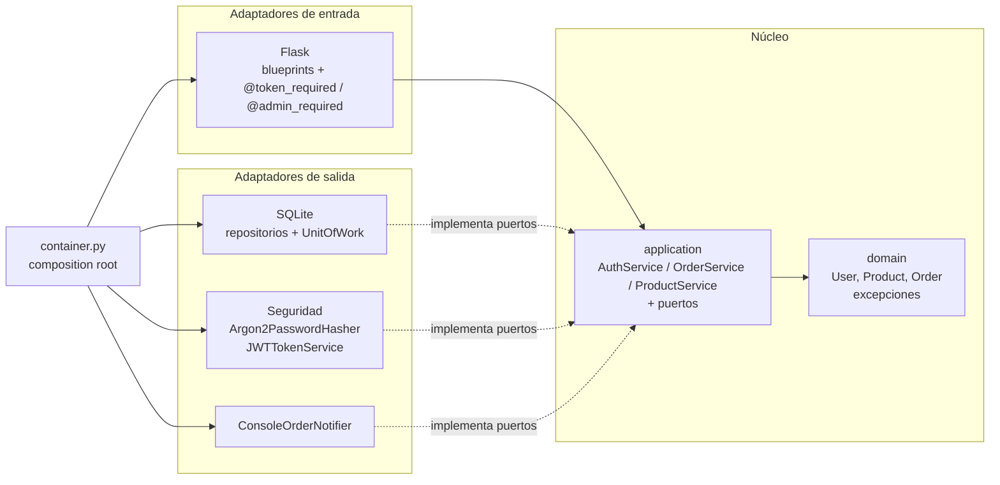
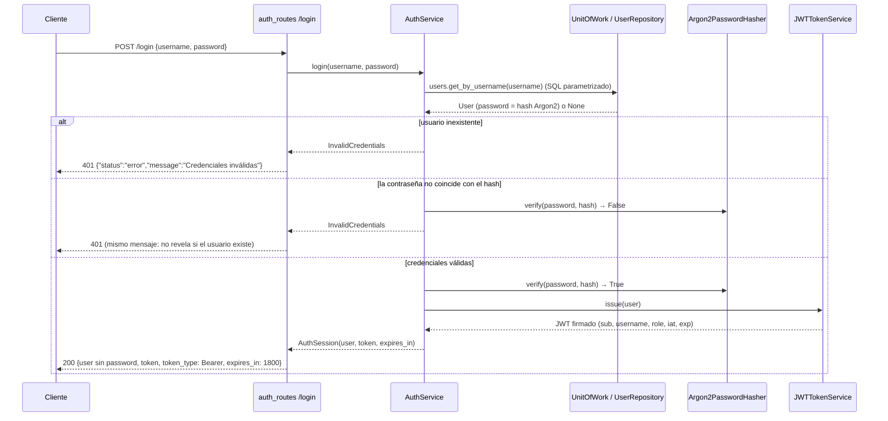
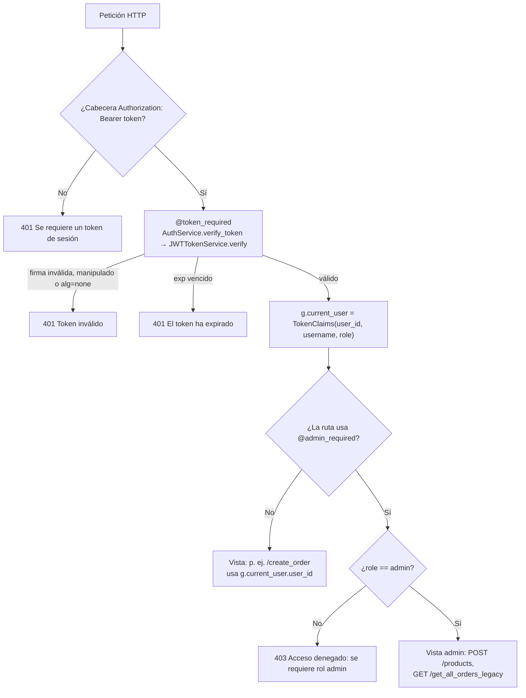

# Arquitectura de OrderHub: Hexagonal (Puertos y Adaptadores)

> **Requisitos cubiertos:**
> - **Primera entrega:** RNF-01.1 (arquitectura hexagonal, Repository Pattern, Dependency Injection), RF-01.1 (inicio de sesión), HU-03.
> - **Segunda entrega:** RF-01.2 (hashing Argon2), RF-01.3 (sesión JWT), RF-01.4 (control de acceso por rol), RNF-01.2 (pruebas de login), RNF-01.3 (PEP 8 con `flake8` y `black`).
>
> **Estado:** la persistencia sigue siendo SQLite (`orderhub.db`). Los secretos todavía se leen de `config.py`; pasar a `.env` es RNF-02.1, fuera de este alcance.

## 1. Resumen del sistema

OrderHub es una API Flask que gestiona usuarios, catálogo de productos y órdenes de compra. Está organizada en tres anillos:

| Anillo | Contenido | Depende de |
| :--- | :--- | :--- |
| **Dominio** (`domain/`) | Entidades `User`, `Product`, `Order` y excepciones de negocio | Nada |
| **Aplicación** (`application/`) | Casos de uso (`AuthService`, `OrderService`, `ProductService`) y **puertos** | Dominio |
| **Adaptadores** (`adapters/`) | Flask (entrada); SQLite, Argon2, JWT y notificador (salida) | Aplicación y dominio |

### Componentes de seguridad

| Componente | Tipo | Responsabilidad | Requisito |
| :--- | :--- | :--- | :--- |
| `PasswordHasher` | Puerto | Contrato para calcular y verificar hashes de contraseñas | RF-01.2 |
| `Argon2PasswordHasher` | Adaptador de salida | Argon2id con sal aleatoria (`argon2-cffi`) | RF-01.2 |
| `TokenService` / `TokenClaims` | Puerto | Contrato para emitir y validar tokens; identidad extraída del token | RF-01.3 |
| `JWTTokenService` | Adaptador de salida | JWT HS256 con `sub`, `username`, `role`, `iat` y `exp` (30 min por defecto) | RF-01.3 |
| `AuthService` | Caso de uso | `register`, `login` (emite el token) y `verify_token` | RF-01.1 a RF-01.3 |
| `@token_required` | Decorador web | Exige `Authorization: Bearer <token>` válido → si no, 401 | RF-01.3 |
| `@admin_required` | Decorador web | Exige token válido con rol `admin` → 401 sin token, 403 con otro rol | RF-01.4 |
| `error_handlers.py` | Adaptador web | Traduce `InvalidCredentials`/`InvalidToken` a 401, `AccessDenied` a 403 y `UserAlreadyExists` a 409 | — |
| `schema.init_db` | Adaptador de salida | Guarda las contraseñas semilla con hash y migra las contraseñas legadas en texto plano | RF-01.2 |

### Endpoints

| Método y ruta | Protección | Descripción |
| :--- | :--- | :--- |
| `GET /` | Pública | Panel HTML con formulario de login |
| `POST /register` | Pública | Crea un usuario con rol `client` |
| `POST /login` | Pública | Devuelve el usuario (sin contraseña) y un JWT |
| `POST /create_order` | `@token_required` | Crea una orden a nombre del usuario del token |
| `GET /get_all_orders_legacy` | `@admin_required` | Lista las órdenes de todos los usuarios |
| `POST /products` | `@admin_required` | Crea un producto (operación administrativa) |

## 2. Regla de dependencias



Las dependencias apuntan **siempre hacia el núcleo**. `domain/` y `application/` no importan `flask`, `sqlite3`, `argon2` ni `jwt`: solo conocen los puertos. Por ejemplo, cambiar Argon2 por bcrypt solo requiere otro adaptador de `PasswordHasher` y una línea en `container.py`.

## 3. Estructura de directorios

```
orderhub/
├── __init__.py                  # create_app(): fábrica de Flask
├── container.py                 # Composition root (Dependency Injection manual)
├── domain/
│   ├── entities.py              # User (role, is_admin), Product (create), Order (place)
│   └── exceptions.py            # InvalidCredentials, InvalidToken, AccessDenied, UserAlreadyExists, ...
├── application/
│   ├── ports/
│   │   ├── repositories.py      # UserRepository, ProductRepository, OrderRepository
│   │   ├── unit_of_work.py      # UnitOfWork (transacción atómica)
│   │   ├── notifier.py          # OrderNotifier
│   │   ├── password_hasher.py   # PasswordHasher          (RF-01.2)
│   │   └── token_service.py     # TokenService, TokenClaims (RF-01.3)
│   └── services/
│       ├── auth_service.py      # register, login, verify_token
│       ├── order_service.py     # create_order, list_orders
│       └── product_service.py   # create_product           (RF-01.4)
└── adapters/
    ├── inbound/web/
    │   ├── auth_decorators.py   # @token_required, @admin_required
    │   ├── auth_routes.py       # POST /register, POST /login
    │   ├── order_routes.py      # POST /create_order, GET /get_all_orders_legacy
    │   ├── product_routes.py    # POST /products
    │   ├── error_handlers.py    # excepciones de dominio → 400/401/403/404/409
    │   ├── serializers.py       # entidades → JSON (sin contraseña)
    │   └── templates/index.html # panel con formulario de login
    └── outbound/
        ├── persistence/sqlite/  # repositorios, UnitOfWork, esquema y migración de contraseñas
        ├── security/
        │   ├── argon2_hasher.py      # Argon2PasswordHasher
        │   └── jwt_token_service.py  # JWTTokenService
        └── notifications/       # ConsoleOrderNotifier
tests/
├── unit/                        # servicios con fakes en memoria + adaptadores Argon2/JWT reales
└── integration/                 # API completa con SQLite temporal
```

`database.py` (legado) se conserva solo como referencia. Ya nada lo importa y está excluido de los linters.

## 4. Patrones de diseño aplicados

| Patrón | Dónde | Para qué |
| :--- | :--- | :--- |
| **Puertos y Adaptadores (Hexagonal)** | `application/ports` ↔ `adapters/` | Cambiar Flask, SQLite, Argon2 o JWT sin tocar el negocio. |
| **Adapter** | `Argon2PasswordHasher`, `JWTTokenService`, `Sqlite*Repository`, `ConsoleOrderNotifier` | Cada uno adapta una librería o tecnología externa (`argon2-cffi`, `PyJWT`, `sqlite3`, `logging`) a la interfaz que espera el núcleo. Por ejemplo, `Argon2PasswordHasher.verify` convierte las excepciones de argon2 en un `bool`. |
| **Decorator** | `@token_required`, `@admin_required` (`auth_decorators.py`) | Agregan autenticación y autorización a una vista sin modificarla. `@admin_required` se construye sobre `@token_required`. |
| **Dependency Injection** | `container.py`; constructores de `AuthService(uow_factory, password_hasher, token_service)`, `OrderService` y `ProductService` | Los servicios reciben sus dependencias. Los tests inyectan `FakePasswordHasher` y `FakeTokenService`; `build_container` acepta hasher y token service alternativos. |
| **Unit of Work** | `UnitOfWork` / `SqliteUnitOfWork` | Una conexión y una transacción por caso de uso: `register`, `create_order` y `create_product` confirman con `commit()` o se deshacen solos. |
| **Repository** | `UserRepository` (`get_by_username`, `add`), `ProductRepository` (`get`, `add`, `update_stock`), `OrderRepository` | Ocultan el SQL parametrizado detrás de operaciones de dominio. |
| **Application Factory** | `create_app()` | Crear la app con distintas configuraciones (producción y tests). |
| **Factory Method** | `Product.create`, `Order.place` | Construir entidades válidas aplicando las reglas de negocio. |

## 5. Flujo de autenticación y autorización

### 5.1 Inicio de sesión (RF-01.1, RF-01.2, RF-01.3)



### 5.2 Petición a una ruta protegida (RF-01.3, RF-01.4)



### 5.3 Registro (RF-01.2)

`POST /register` → `AuthService.register` valida los datos (usuario obligatorio, contraseña de al menos 8 caracteres) → comprueba que el nombre no exista (si existe, 409) → `PasswordHasher.hash` → `UserRepository.add` con rol `client` → `commit()` → 201. El rol nunca se toma de la petición, así que nadie puede registrarse como `admin`.

## 6. Referencia de funciones nuevas o modificadas (segunda entrega)

### Dominio
| Función / clase | Descripción |
| :--- | :--- |
| `User.is_admin` | `True` si `role == "admin"`. Constantes `ROLE_ADMIN` y `ROLE_CLIENT`. |
| `Product.create(name, price, stock)` | Crea un producto válido. Lanza `InvalidInput` si el nombre está vacío, el precio no es positivo o finito, o el stock es negativo. |
| `InvalidToken`, `AccessDenied`, `UserAlreadyExists` | Nuevas excepciones de dominio (se traducen a 401, 403 y 409). |

### Puertos
| Función / clase | Descripción |
| :--- | :--- |
| `PasswordHasher.hash(plain)` | Devuelve el hash a guardar. |
| `PasswordHasher.verify(plain, hash)` | `bool`; nunca lanza por un hash inválido. |
| `PasswordHasher.is_hash(value)` | Reconoce si un valor ya es un hash (para migrar contraseñas legadas). |
| `TokenService.issue(user)` | Token firmado que expira tras `expires_in_seconds`. |
| `TokenService.verify(token)` | Devuelve `TokenClaims` o lanza `InvalidToken`. |
| `TokenClaims(user_id, username, role)` / `.is_admin` | Identidad del portador del token (inmutable). |
| `UserRepository.add(user)`, `ProductRepository.add(product)` | Persisten una entidad nueva y la devuelven con su `id`. |

### Casos de uso
| Función / clase | Descripción |
| :--- | :--- |
| `AuthService(uow_factory, password_hasher, token_service)` | Recibe los tres puertos por inyección. |
| `AuthService.register(username, password)` | Crea un usuario `client` guardando solo el hash. Errores: `InvalidInput`, `UserAlreadyExists`. |
| `AuthService.login(username, password)` | Verifica con `PasswordHasher` y devuelve `AuthSession(user, token, expires_in)`. Error: `InvalidCredentials`. |
| `AuthService.verify_token(token)` | `TokenClaims` del token; `InvalidToken` si falta o no es válido. |
| `ProductService.create_product(name, price, stock)` | Valida con `Product.create` y persiste en una Unit of Work. |

### Adaptadores
| Función / clase | Descripción |
| :--- | :--- |
| `Argon2PasswordHasher(argon2=None)` | Argon2id con los parámetros por defecto de argon2-cffi (m=64 MiB, t=3, p=4). `verify` captura `VerificationError` e `InvalidHashError`. |
| `JWTTokenService(secret_key, expires_minutes=30, clock=_utcnow)` | Firma HS256. `verify` exige `exp`, `iat` y `sub`, y acepta solo HS256 (rechaza `alg=none`). `clock` es inyectable para probar la expiración. |
| `token_required(view)` | Lee `Authorization: Bearer`, valida el token y guarda `g.current_user`. |
| `admin_required(view)` | `token_required` + verificación de rol → `AccessDenied` (403). |
| `auth_routes.register()` / `login()` | `POST /register` (201) y `POST /login` (200 con `token`, `token_type`, `expires_in`). |
| `product_routes.create_product()` | `POST /products` (solo admin). |
| `serializers.product_to_dict()` | Serializa un producto. |
| `schema.init_db(db_path, password_hasher)` / `_migrate_plaintext_passwords` | Guarda la semilla con hash y re-hashea las contraseñas legadas en texto plano al arrancar. |
| `build_container(db_path, secret_key, token_expires_minutes=30, password_hasher=None, token_service=None)` | Arma Argon2 + JWT por defecto y permite sustituirlos. |

## 7. Cambios de comportamiento de la API

| Endpoint | Antes (primera entrega) | Ahora |
| :--- | :--- | :--- |
| `POST /login` | `{status, user}` | `{status, user, token, token_type, expires_in}` |
| `POST /register` | No existía | 201 / 400 / 409 |
| `POST /create_order` | Pública; `user_id` tomado del cuerpo | Requiere token (401 sin él); el `user_id` sale del token y el del cuerpo se ignora |
| `GET /get_all_orders_legacy` | Pública | Solo admin (401 / 403) |
| `POST /products` | No existía | Solo admin: 201 / 400 / 401 / 403 |
| Contraseñas en BD | Texto plano | Hash Argon2id; las existentes se migran al arrancar |
| Panel `/` | Botón de órdenes sin autenticación | Formulario de login; el token se guarda solo en memoria y se envía como `Bearer` |

Los cambios respecto al legado de la primera entrega siguen vigentes: inyección SQL eliminada, sin contraseña en las respuestas, cantidades inválidas → 400 y transacción atómica en `create_order`.

## 8. Calidad: pruebas y linters

- **Pruebas** (`python -m pytest`): 67 pruebas.
  - `tests/unit/test_auth_service.py`: login exitoso (devuelve usuario y token) y login fallido (contraseña incorrecta, usuario inexistente, inyección SQL, campos vacíos, enviar el hash como contraseña), además de registro y validación de token.
  - `test_argon2_hasher.py` y `test_jwt_token_service.py`: prueban los adaptadores con las librerías reales (sal aleatoria, token expirado, firma ajena, token manipulado, `alg=none`).
  - `tests/integration/test_api.py`: 401, 403 y 409 de extremo a extremo y migración de contraseñas legadas.
- **PEP 8:** `black --check .` sin cambios y `flake8` con 0 avisos. La configuración está en `pyproject.toml` (black, 88 columnas) y `.flake8` (88 columnas; ignora E203/W503 por compatibilidad con black).

## 9. Próximos pasos que esta estructura facilita

- **RNF-02.1 (.env):** leer `SECRET_KEY`, la ruta de la BD y `token_expires_minutes` del entorno en `app.py`, y rotar la clave expuesta en `config.py`.
- **PostgreSQL/SQLAlchemy:** agregar `adapters/outbound/persistence/postgres/` y cambiar una línea en `container.py`.
- **RF-04.1 (notificación asíncrona):** otro adaptador de `OrderNotifier` (cola o correo).
- **Revocación de tokens / refresh tokens:** se agregan detrás del puerto `TokenService` sin tocar los decoradores.

## 10. Cómo ejecutar

```bash
pip install -r requirements.txt
python app.py              # http://localhost:5000
python -m pytest -q        # pruebas unitarias y de integración
black --check . && flake8  # estilo PEP 8
```

Ejemplo de uso con token:

```bash
curl -s -X POST localhost:5000/login -H "Content-Type: application/json" -d '{"username":"admin","password":"admin123"}'
curl -s -X POST localhost:5000/products -H "Authorization: Bearer <token>" -H "Content-Type: application/json" -d '{"name":"Teclado","price":45,"stock":10}'
```
