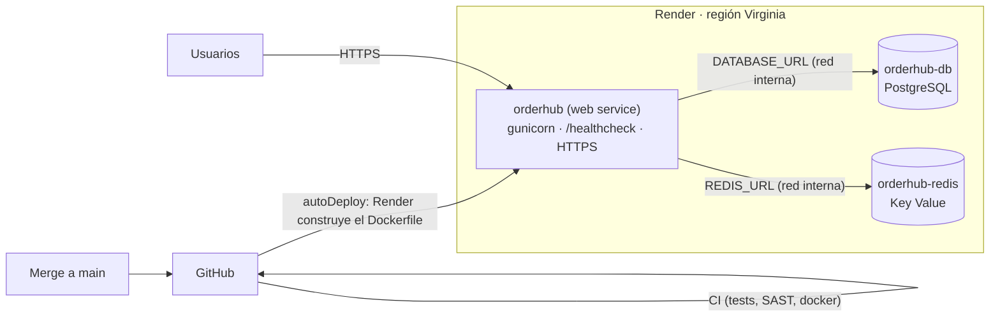

# Despliegue en Render

> **Por qué Render:** es una plataforma como servicio (PaaS) que construye la imagen desde nuestro `Dockerfile`, entrega una URL pública con HTTPS y crea la base de datos y Redis desde un solo archivo (`render.yaml`). Fue la alternativa sugerida por el docente mientras la suscripción de Azure seguía bloqueada en el registro de proveedores (ver `AZURE_DEPLOYMENT.md`).

## 1. Arquitectura

| Recurso (`render.yaml`) | Tipo | Plan | Conexión |
| :--- | :--- | :--- | :--- |
| `orderhub` | Web service con runtime Docker | free | Usa nuestro `Dockerfile` sin cambios. Render asigna el puerto en `PORT` y `gunicorn.conf.py` ya lo lee |
| `orderhub-db` | PostgreSQL | free | `DATABASE_URL` se inyecta sola (`fromDatabase`) y activa el adaptador PostgreSQL |
| `orderhub-redis` | Key Value (compatible con Redis) | free | `REDIS_URL` se inyecta sola (`fromService`) y activa el `RedisOrderNotifier` |

**No cambió nada del código:** la app ya leía todo del entorno (RNF-02.1) y elegía el adaptador según `DATABASE_URL`. El despliegue en Render es solo configuración.

## 2. Secretos

- `SECRET_KEY`: la genera Render (`generateValue: true`); no existe en ningún archivo.
- `SEED_ADMIN_PASSWORD` y `SEED_CLIENT_PASSWORD`: `sync: false`, así que Render las pide al crear el Blueprint. Deben ser contraseñas fuertes, distintas de las de desarrollo, porque la URL es pública.
- `DATABASE_URL` y `REDIS_URL`: las arma Render con credenciales propias y solo funcionan dentro de su red interna.

## 3. Pasos

1. Hacer merge a `main` del PR que trae `render.yaml`.
2. Entrar a **render.com** → *Get Started* → **registrarse con GitHub**.
3. En el dashboard: **New + → Blueprint** → conectar GitHub y dar acceso al repositorio `legacy-order-hub`.
4. Elegir el repositorio y la rama `main`. Render muestra los 3 recursos de `render.yaml`.
5. Escribir las dos contraseñas semilla → **Apply** (o *Deploy Blueprint*).
6. Esperar el primer build (5–10 min) y abrir la URL `https://orderhub-xxxx.onrender.com`.

Desde ese momento, **cada merge a `main` despliega solo** (`autoDeploy: true`). Si una versión nueva no responde en `/healthcheck`, Render no le pasa tráfico y mantiene la anterior: un despliegue sin caída.

## 4. Limitaciones del plan gratuito

- **El servicio se duerme** tras unos 15 minutos sin tráfico; la primera petición después tarda unos 30–60 s. Para una demo, abrir la URL un minuto antes.
- **La PostgreSQL gratuita caduca a los 30 días** (Render avisa por correo). Alcanza para la entrega; después se puede pasar a un plan pago.
- **Sin worker:** los *background workers* no tienen plan gratis. Los eventos de órdenes quedan encolados en Redis sin procesarse; la API y las órdenes funcionan igual. Para activarlo, se agrega un servicio `type: worker` con `dockerCommand: python worker.py` (plan *starter*).
- **Sin Prometheus ni Grafana en la nube:** las métricas siguen en `/metrics` y los logs JSON se ven en la pestaña *Logs* de Render.
