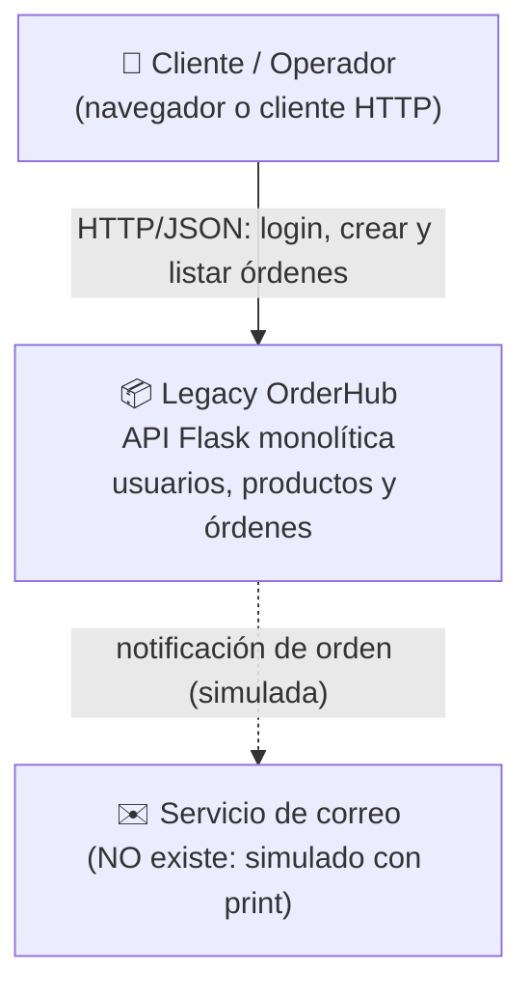
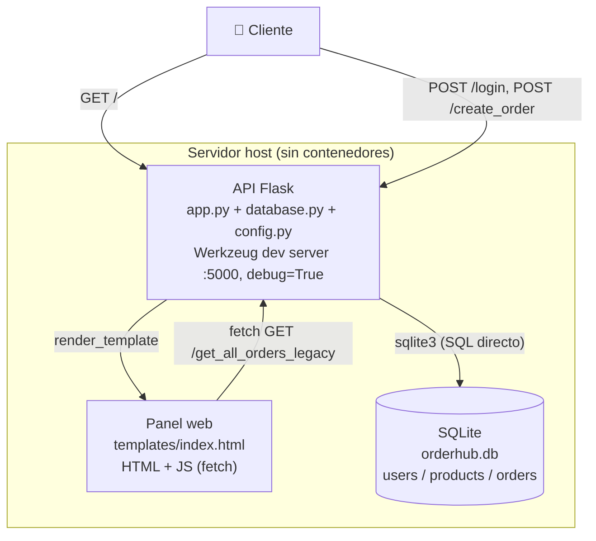
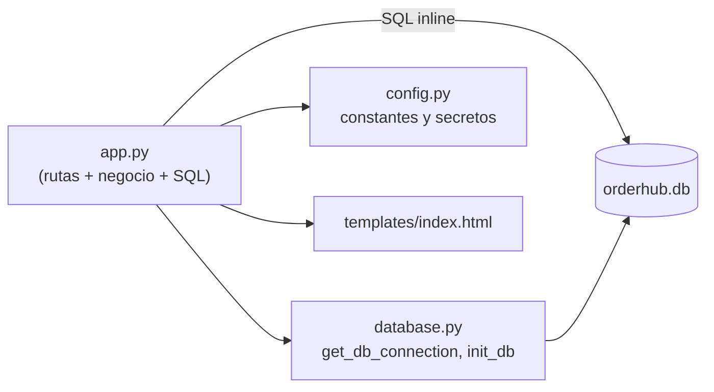
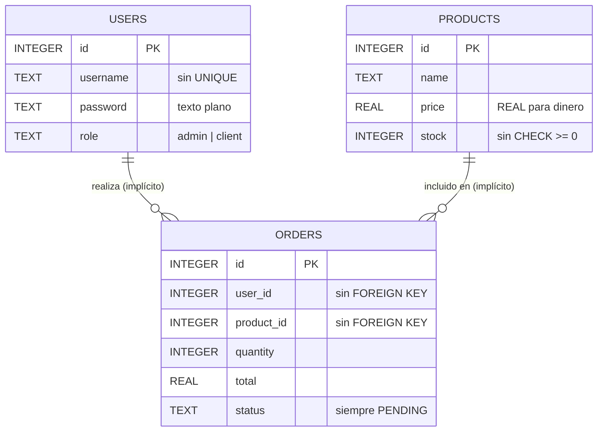
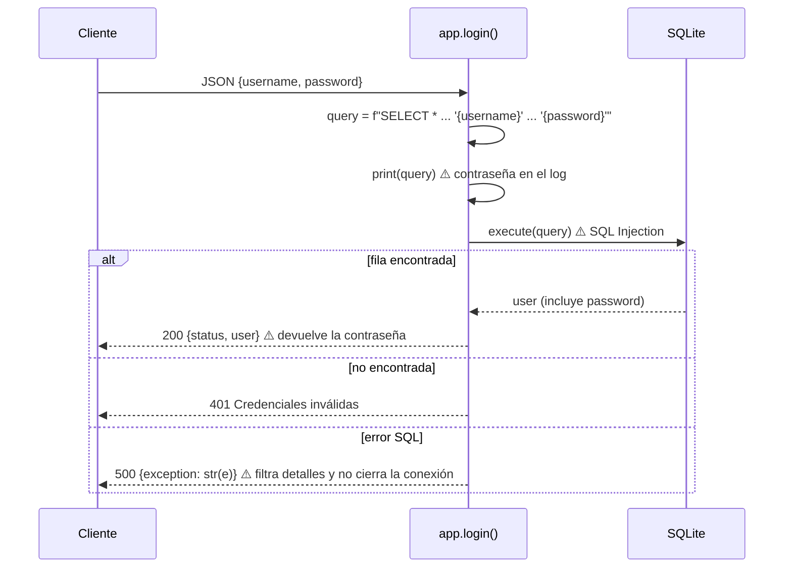
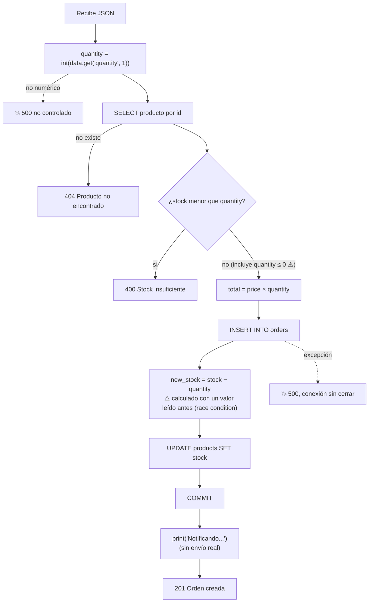

# Ingeniería Inversa del Sistema Legado (Legacy OrderHub v1.0.0)

> **Historia de usuario:** HU-01 – Auditoría de Código, Seguridad e Ingeniería Inversa
> **Alcance:** código de la rama `main` (commit `2d6a20b`): `app.py`, `database.py`, `config.py`, `templates/index.html`, `requirements.txt`.
> **Fecha:** 2026-10-19

---

## 0. Metodología (ingeniería inversa asistida por IA)

1. **Análisis estático con IA:** se le dio a un agente de IA (Claude Code) acceso de solo lectura al repositorio. Leyó cada archivo y extrajo el flujo de control, el modelo de datos y las dependencias entre módulos.
2. **Recuperación de diseño:** a partir de ese análisis se reconstruyeron los diagramas (C4, ER, secuencia y flujo) y se clasificaron los patrones y antipatrones presentes.
3. **Verificación dinámica:** cada hallazgo se comprobó ejecutando la aplicación legada en una copia aislada con el cliente de pruebas de Flask. Los resultados reales aparecen en la sección 5.
4. **Revisión humana:** el equipo revisó lo generado por la IA antes de incorporarlo a la documentación.

Ninguna conclusión sale solo de la IA: lo que se afirma sobre el comportamiento del sistema está respaldado por el código citado (`archivo:línea`) o por una ejecución real.

---

## 1. Resumen del sistema

**Legacy OrderHub** es una API web monolítica escrita en **Python + Flask** con persistencia en **SQLite**. Gestiona tres conceptos de negocio:

| Concepto | Tabla | Qué hace el sistema con él |
| :--- | :--- | :--- |
| Usuarios | `users` | Autentica con usuario y contraseña (`POST /login`). |
| Productos | `products` | Consulta precio y stock; descuenta stock al vender. No hay endpoint para administrarlos. |
| Órdenes | `orders` | Crea órdenes (`POST /create_order`) y las lista todas (`GET /get_all_orders_legacy`). |

Además, sirve un panel HTML (`GET /`) con un botón que consulta el listado de órdenes.

**Características estructurales:**
- **Tamaño:** unas 150 líneas de Python en 3 módulos, más 1 plantilla HTML.
- **Arquitectura:** una sola capa. Cada handler HTTP de `app.py` hace todo: lee la petición, aplica reglas de negocio, ejecuta SQL y "notifica".
- **Estado:** todo el estado vive en el archivo `orderhub.db`, creado en el directorio desde donde se ejecuta la app.
- **Sin** autenticación en los endpoints de órdenes, sesiones, pruebas, logging estructurado, migraciones ni manejo de errores coherente.
- **Integraciones externas:** ninguna real. La "notificación por correo" es un `print()` (`app.py:69`). La dependencia `requests` está declarada pero no se usa.

---

## 2. Diagramas

### 2.1 C4 – Nivel 1: Contexto

### 2.2 C4 – Nivel 2: Contenedores

### 2.3 Dependencias entre módulos

`app.py` accede a la base de datos de dos formas: a través de `database.py` para obtener la conexión y escribiendo él mismo todo el SQL. No existe una capa de acceso a datos.

### 2.4 Modelo de datos (ER)

Las relaciones solo existen en la lógica de la aplicación. El esquema (`database.py:12-39`) no declara claves foráneas, restricciones `UNIQUE`/`NOT NULL`/`CHECK` ni índices.

### 2.5 Secuencia: `POST /login`

### 2.6 Flujo: `POST /create_order` y sus puntos de falla

---

## 3. Documentación de cada función

### 3.1 `database.py`

#### `get_db_connection() -> sqlite3.Connection` (`database.py:3`)
- **Propósito:** abrir una conexión nueva a la base de datos SQLite.
- **Entradas:** ninguna. La ruta `'orderhub.db'` está escrita en el código y es relativa al directorio de trabajo.
- **Salida:** conexión con `row_factory = sqlite3.Row`, para leer columnas por nombre (`row['stock']`) y convertir filas con `dict(row)`.
- **Efectos laterales:** si el archivo no existe, SQLite lo crea.
- **Observaciones:** ignora `config.DB_NAME` (`"orderhub_db"`), así que la configuración y el código no coinciden. Abre una conexión nueva en cada llamada, sin pool ni gestor de contexto. Cerrarla queda a cargo de quien la llama.

#### `init_db() -> None` (`database.py:8`)
- **Propósito:** crear el esquema y cargar datos semilla.
- **Comportamiento:**
  1. `CREATE TABLE IF NOT EXISTS` para `users`, `products` y `orders`.
  2. Si `users` está vacía, inserta 2 usuarios (`admin/admin123` con rol admin y `juan/123456` con rol client) y 2 productos (`Laptop Legada`, $1200, stock 5; `Mouse USB`, $15.50, stock 50).
- **Efectos laterales:** escribe en disco. Se ejecuta **al importar `app.py`** (`app.py:9`), así que cualquier import del módulo, incluidas las pruebas, toca la base de datos real.
- **Observaciones:** la carga de productos depende de que `users` esté vacía, aunque son entidades independientes. Las contraseñas semilla quedan en texto plano dentro del código. No hay versionado del esquema (migraciones).

### 3.2 `app.py`

#### Nivel de módulo (`app.py:1-9`, `86-87`)
- Crea la aplicación Flask global `app`, le asigna `SECRET_KEY` desde `config.py` y llama a `init_db()`.
- `if __name__ == '__main__'`: arranca el servidor de desarrollo de Werkzeug en `0.0.0.0:5000` con `debug=True`.
- **Observaciones:** `import sqlite3` no se usa. `SECRET_KEY` se configura, pero la app no usa sesiones ni cookies firmadas. `debug=True` junto con `host='0.0.0.0'` expone a la red el depurador interactivo de Werkzeug (permite ejecutar código y solo lo protege un PIN).

#### `index()` – `GET /` (`app.py:11`)
- **Propósito:** mostrar el panel `templates/index.html`.
- **Entradas/salidas:** ninguna entrada; devuelve HTML, 200.
- **Observaciones:** deja un comentario con HTML antiguo (código muerto, `app.py:14`).

#### `login()` – `POST /login` (`app.py:16`)
- **Propósito:** autenticar a un usuario por nombre y contraseña.
- **Entrada:** JSON `{"username": str, "password": str}`.
- **Salidas:**

  | Caso | Código | Cuerpo |
  | :--- | :--- | :--- |
  | Credenciales válidas | 200 | `{"status":"success","user":{id, username, password, role}}` |
  | Inválidas | 401 | `{"status":"error","message":"Credenciales inválidas"}` |
  | Error SQL | 500 | `{"status":"error","exception":"<mensaje de SQLite>"}` |
  | Cuerpo no JSON | 415 | Error HTML de Flask |

- **Lógica:** interpola `username` y `password` dentro de un f-string SQL (`app.py:25`), imprime la consulta y la ejecuta. La comparación de contraseñas la hace la propia consulta SQL.
- **Defectos:** inyección SQL; contraseña en texto plano, impresa en consola y devuelta en la respuesta; la conexión no se cierra en la rama de excepción; un nombre con apóstrofe (p. ej. `o'brien`) provoca un 500. No emite ningún token ni sesión: el cliente no recibe ninguna prueba de que se autenticó.

#### `create_order()` – `POST /create_order` (`app.py:37`)
- **Propósito:** registrar una orden de compra y descontar el inventario.
- **Entrada:** JSON `{"user_id": int, "product_id": int, "quantity": int = 1}`.
- **Salidas:**

  | Caso | Código | Cuerpo |
  | :--- | :--- | :--- |
  | Orden creada | 201 | `{"message":"Orden creada con éxito","order_id":int,"total":float}` |
  | Producto inexistente | 404 | `{"error":"Producto no encontrado"}` |
  | Stock insuficiente | 400 | `{"error":"Stock insuficiente"}` |
  | `quantity` no numérico | 500 | Error HTML (excepción no controlada) |

- **Lógica (Transaction Script):** convierte `quantity` → busca el producto → valida stock → calcula `total = price × quantity` → `INSERT` de la orden con estado `'PENDING'` → calcula `new_stock` en Python → `UPDATE` del stock → `COMMIT` → `print` de la "notificación".
- **Defectos:**
  - No valida que `quantity > 0`. Una cantidad negativa crea una orden con total negativo y **aumenta** el stock (verificado, sección 5).
  - No valida que `user_id` exista ni que el usuario esté autenticado: cualquiera puede crear órdenes a nombre de cualquier usuario.
  - El stock se recalcula en Python con un valor leído antes (*lost update*): dos compras simultáneas pueden vender más unidades de las que hay.
  - Si ocurre una excepción después de abrir la conexión, no hay `rollback` ni `close` explícitos.
  - La notificación es sincrónica y simulada. Si fuera real y fallara, la orden ya estaría confirmada sin aviso (README, "Falta de Manejo de Errores").
  - Mezcla HTTP, reglas de negocio, persistencia y notificación (viola SRP).

#### `get_orders()` – `GET /get_all_orders_legacy` (`app.py:77`)
- **Propósito:** devolver todas las órdenes.
- **Entrada:** ninguna. **Salida:** 200, lista JSON de `{id, user_id, product_id, quantity, total, status}`.
- **Defectos:** no requiere autenticación y expone todas las órdenes de todos los usuarios. No tiene paginación (se degrada al crecer la tabla). El nombre de la función no coincide con el de la ruta.

### 3.3 `config.py`
Módulo de constantes: `DB_HOST`, `DB_USER`, `DB_PASS`, `DB_NAME`, `SECRET_KEY`.
- Contiene **secretos en el código** (`DB_PASS`, `SECRET_KEY`), versionados en Git.
- `DB_HOST/USER/PASS/NAME` **no se usan** en ningún lado. Parecen restos de un plan de usar un motor cliente-servidor (p. ej. MySQL).

### 3.4 `templates/index.html`
#### `fetchOrders()` (JavaScript)
- **Propósito:** al pulsar el botón, pedir `GET /get_all_orders_legacy` y mostrar el JSON formateado en un `<pre>`.
- **Observaciones:** no verifica `response.ok`, así que un error HTTP con cuerpo JSON se muestra como si fuera un resultado válido. Usa `textContent`, lo que evita XSS al pintar los datos.

### 3.5 `requirements.txt`
`Flask==3.1.3`, `Werkzeug==3.1.8` y `requests==2.25.1`. `requests` **no se importa en ningún módulo** y su versión es muy antigua, con vulnerabilidades públicas conocidas. Debe eliminarse o actualizarse. No hay dependencias de desarrollo (pytest, linters).

---

## 4. Identificación de patrones de diseño

### 4.1 Patrones presentes

| Patrón | Dónde | Comentario |
| :--- | :--- | :--- |
| **Transaction Script** (Fowler, PoEAA) | `login`, `create_order`, `get_orders` | Cada caso de uso es un procedimiento que va de la petición a la base de datos. Es el patrón dominante y la raíz del acoplamiento. |
| **Front Controller** (lo provee Flask) | `@app.route` | Flask centraliza las peticiones y las despacha a cada vista. |
| **Decorator** (de lenguaje) | `@app.route(...)` | Registro de rutas mediante decoradores de Python. |
| **Simple Factory** | `get_db_connection()` | Encapsula la creación y configuración de la conexión. |
| **Template View** | `render_template('index.html')` | Vista generada con plantilla Jinja2. |
| **Module Singleton / Global** | `app` global, `config` como módulo | Una sola instancia compartida a nivel de módulo; impide crear apps distintas para pruebas. |

### 4.2 Antipatrones y olores de código

| Antipatrón / olor | Evidencia | Impacto |
| :--- | :--- | :--- |
| **Big Ball of Mud / God Module** | `app.py` concentra HTTP, negocio y SQL | Cualquier cambio arriesga todo el sistema. |
| **Smart UI / lógica en el controlador** | Cálculo del total y validación de stock dentro del handler | Las reglas no se pueden reutilizar ni probar de forma aislada. |
| **SQL Injection** (OWASP A03) | `app.py:25` | Acceso sin contraseña como `admin`. |
| **Hardcoded Secrets** (OWASP A02/A05) | `config.py`, `database.py:43-44` | Credenciales expuestas en el repositorio. |
| **Contraseñas en texto plano** | esquema `users`, `database.py:43` | Una fuga de la BD expone todas las cuentas. |
| **Fuga de información sensible** | `print(query)` con contraseña; `dict(user)` en la respuesta; `str(e)` al cliente | Credenciales en logs y respuestas. |
| **Falta de control de acceso** (OWASP A01) | `/create_order` y `/get_all_orders_legacy` sin autenticación | Cualquiera lee o crea órdenes. |
| **Configuración insegura** | `debug=True`, `host='0.0.0.0'` | Depurador de Werkzeug accesible desde la red. |
| **Efectos laterales al importar** | `init_db()` en `app.py:9` | Importar el módulo escribe en la BD real. |
| **Validación de entrada ausente** | `quantity` sin validar | 500 con texto; stock manipulable con cantidades negativas. |
| **Condición de carrera (lost update)** | `app.py:64-65` | Sobreventa con compras concurrentes. |
| **Fuga de recursos** | Ramas de excepción sin `conn.close()` | Conexiones abiertas ante errores. |
| **Magic strings** | `'PENDING'`, `'orderhub.db'`, puerto `5000` | Valores duplicados y difíciles de cambiar. |
| **Código y configuración muertos** | `import sqlite3`, `DB_*` sin uso, `requests`, comentario HTML | Ruido y falsa sensación de configuración. |
| **Logging con `print`** | `app.py:26`, `app.py:69` | Sin niveles, formato ni trazabilidad. |
| **Respuestas inconsistentes** | `{"status","message"}` vs `{"error"}` vs `{"exception"}` | El cliente no tiene un formato de error estable. |

---

## 5. Evidencia de verificación dinámica

Pruebas ejecutadas sobre una copia aislada del código legado (base de datos nueva) con el cliente de pruebas de Flask:

| Entrada | Resultado observado |
| :--- | :--- |
| `POST /login` `{"username":"admin' --","password":"x"}` | **200**, sesión como `admin`; la respuesta incluye `"password":"admin123"`. Consola: `SELECT * FROM users WHERE username = 'admin' --' AND password = 'x'` |
| `POST /login` `{"username":"' OR '1'='1","password":"' OR '1'='1"}` | **200**, devuelve el primer usuario (`admin`) con su contraseña |
| `POST /login` `{"username":"o'brien","password":"x"}` | **500** `{"exception":"near \"brien\": syntax error"}` |
| `POST /login` con cuerpo no JSON | **415** |
| `POST /create_order` `{"user_id":2,"product_id":2,"quantity":-10}` | **201**; orden con `total: -155.0`; el stock del Mouse USB pasa de **50 a 60** |
| `POST /create_order` `{"product_id":2,"quantity":"abc"}` | **500** (`ValueError` no controlado) |

---

## 6. Conclusiones y relación con el backlog

| Hallazgo | Requisito / HU que lo resuelve |
| :--- | :--- |
| Monolito en una sola capa (Transaction Script) | RNF-01.1, HU-03: arquitectura hexagonal (PR #1, `feature/hexagonal-architecture`) |
| Inyección SQL en `/login` | RNF-02.2, HU-02 (consultas parametrizadas, ya en el PR #1) |
| Contraseñas en texto plano | RF-01.2 (bcrypt/argon2) |
| Login sin token ni sesión | RF-01.3 (JWT) |
| Endpoints sin control de acceso | RF-01.3, RF-01.4 |
| Secretos en `config.py` | RNF-02.1, HU-02 (`.env`) |
| Stock sin transacción ni validación | RF-02.3, RF-03.3 |
| `print` como logging y notificación | RNF-05.1, RF-04.1, HU-08 |
| 0 % de pruebas | RNF-01.2, HU-04 |
| `debug=True`, puerto fijo, sin contenedores | RNF-03, HU-06 |
